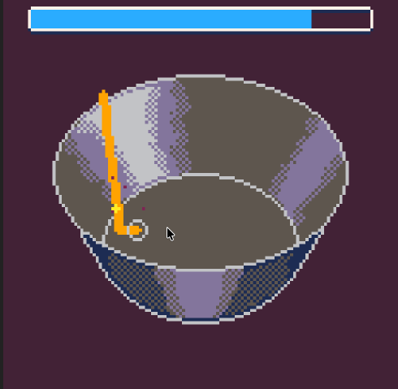
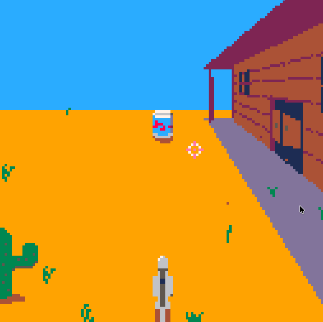
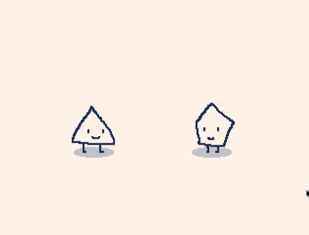

*PICOJAM26 pixel art done by [mabbees](https://mabbees.itch.io/).*

[日本語版はこちら。](/blog/posts/2026-09-24-PICOJAM-2026-JP/)

Last August was PICOJAM 26, a two-day in-person PICO-8 and Picotron-only game jam in Tokyo held at the Pico Pico Café.

## What's PICO-8? Picotron?

[PICO-8](https://www.lexaloffle.com/pico-8.php) is a fantasy console that is for making, sharing and playing tiny games. Games are in 8-bit color, and the engine includes a code editor, a sprite maker, a map editor, and a music/SFX maker all in one. It’s based in Lua and has a forum of sweet and dedicated fans. Notably, Matt Thorston and Noel Berry’s [Celeste](https://www.lexaloffle.com/bbs/?tid=2145) and donuthunters’s [MOTION REC](https://www.lexaloffle.com/bbs/?tid=53392) were originally made in PICO-8.

[Picotron](https://www.lexaloffle.com/picotron.php) is a **Fantasy Workstation:** a self-contained creative environment built for imaginary hardware. It runs on Lua, the same as PICO-8, and extends from games to apps, wallpapers and other fun widgets.

There’s a lot of reasons why PICO-8 and Picotron are fun to develop in; the main one is that a lot of decisions are already made for you so you can focus on making something cool. Open Unreal Engine and you may marvel at the switches for hours—but in PICO-8 or Picotron you can start making a game the moment it boots up.

## How was PICOJAM 26?

Last year's theme was 祭り・溶ける (festival/melt) which inspired fun summer-themed games.

[Check out last year's after report here.](/blog/posts/2025-09-08-PICOJAM-2025/)

The theme this year was much more conceptual - the Japanese hiragana character ま "ma" which could be read as 間 (white space, timing), 馬 (horse), 魔 (magic), or any number of Japanese words that start with the character "ma".

We had ten participants and made seven games, five PICO-8 games and two Picotron games. There is one ghost Picotron game that still isn't out, which I'll get to...

( [**Check out the jam page here on itch.**](https://itch.io/jam/picojam26) )

Pico Pico Café is a beautiful, sunlit space and was perfect for a small, cozy jam. The first day, most folks were silent, *click-clacking* on their keyboards or puzzling over game design. We had a half Japanese, half non-Japanese split; everyone spoke Japanese primarily. People drifted in and out in the daytime, and in the evening, we all had curry at a nearby Indian restaurant.

The second day there were smiles, laughter and jokes being explained in English and in Japanese as puns came together, animations got sillier, sound effects were added and people got looser. My favorite moment in the jam was when one of the jammers asked another to record sound effects in PICO-8; I had to fight off laughter because his voice acting was just *so perfect* and the other jammer's smile got bigger and bigger the more sound effects were made.

This is the secret sauce of a jam: collaboration and silliness. As working adults, it takes a lot of motivation to sign up for a two or three-day jam—we might think, *who will look after my kid?* or *I have home projects that day...* or *I'm just tired from work...*. These are all valid and ones I think about too—especially as an organizer!-but each year I'm amazed at how fun and rejeuvenating a jam weekend can be.

I leave the weekend with new friendly faces, a new game to poke around in, and a new sense of confidence that I've made something new.

I organize two jams a year-a 40+ person one in January for Global Game Jam and a ~10 person one in August for PICOJAM.

## The games

mabbees made us a compilation cart! [You can play it on the BBS here.](https://www.lexaloffle.com/bbs/?tid=159785) The Picotron games are not included.

### Derpy Derby (Picotron)

**Made by:** [Acedio](https://acedio.itch.io/), [illuminesce](https://illuminesce.itch.io/), and [zep](https://zep.itch.io/)

This was our game!

A typing game about moving a horse's front and back legs independent of each other to win a race.

I used this jam as an opportunity to learn more about developing in Picotron. Acedio was the main programmer, but I learned how to hook up the Picotron Drive to Git and how to specify custom color palettes. I admit, the first sprites I gave him were quite small - I was so used to working in PICO-8's resolution and Picotron's is so much bigger! Acedio and I worked on some improvements, which you can see here.

( [**Play on itch.io**](https://illuminesce.itch.io/derpy-derby) | [**Play on the Lexaloffle BBS**](https://www.lexaloffle.com/bbs/?tid=158729) )

### ほ-のぼうけん (PICO-8)

**Made by:** [donutshunter](https://donutshunter.itch.io/), [CornetTheory](https://cornettheory.itch.io/)

You play as a mysterious character who is trying to figure out the world fits around you. Sokoban-style RPG with a cute story.

donutshunter did a great job on this - he has an excellent design sense for characters that is simple and easily recognizeable. The game features a hyper-compressed version of CornetTheory's excellent voice acting work.

( [**Play on itch.io**](https://donutshunter.itch.io/gestalt-ma) | [**Play on the Lexaloffle BBS**](https://www.lexaloffle.com/bbs/?tid=159607) )

### Maho Tofu (PICO-8)

**Made by:** [mabbees](https://mabbees.itch.io/), [illuminesce](https://illuminesce.itch.io/)

You seem to have misplaced your spellbooks and your cookbooks. You'll have to discover the glyph shapes on your own. Good luck, chef!

mabbees also has a distinct style that has been shaped from our work on [Tomodachi 8in1](https://illuminesce.itch.io/tomodachi-8in1) - hyper-realistic, pixel-perfect food that is positively mouth-watering. I helped with some of the sprites and tried to match styles accordingly.

( [**Play on itch.io**](https://mabbees.itch.io/maho-tofu) | [**Play on the Lexaloffle BBS**](https://www.lexaloffle.com/bbs/?tid=158727) )

### The Good, The Bad, and the PICO-8. (PICO-8)

**Made by:** [hiko](https://hikokyoujurou.itch.io/), [mabbees](https://mabbees.itch.io/)

Using your trusty six-shooter, engage in various gun battles to be the fastest gun in the West! 

From the beginning, hiko wanted to do a Western-type shooter that he could play on a Miyoo Mini console and the gameplay lends itself well to this. Western music by mabbees!

( [**Play on itch.io**](https://hikokyoujurou.itch.io/duel-pico) | [**Play on the Lexaloffle BBS**](https://www.lexaloffle.com/bbs/?tid=159703) )

### Dit Dit Dah (PICO-8)

**Made by:** [Kenta Saito](https://kenta-saito.itch.io/), [CornetTheory](https://cornettheory.itch.io/)

A Morse-code inspired memory game! You listen to a pattern, then try to recreate it. Judgment is about the pattern of dits, dahs, and silence. Get it exact for great!, land close for close, or miss for bad. After a miss, you can retry the same word while still seeing your last attempt.

This was Kenta's first game jam in PICO-8, which meant he fought bravely through difficulties and worries that he woudln't be able to make this game a reality. This was a great prototype for very unique gameplay.

( [**Play on itch.io**](https://itch.io/jam/picojam26/rate/4902289) | [**Play on the Lexaloffle BBS**](https://www.lexaloffle.com/bbs/?tid=158726) )

### Manhole Brushers (PICO-8)

**Made by:** [uchuzine](https://uchuzine.itch.io/), [Owljey](https://owljey.itch.io/)

A two-player, legally distinct game about two brushers who need to get those pipes clean! Use your brush, brush the stains and run the water - and don't forget to duck!

This game had a lot of parallels to uchuzine and shoma's game for Global Game Jam, [TRUST ME](https://www.lexaloffle.com/bbs/index.php?tid=140024).

([**Play on itch.io**](https://uchuzine.itch.io/manhole-brushers) | [**Play on the Lexaloffle BBS**](https://www.lexaloffle.com/bbs/?pid=194831) )

### The Chat (Picotron)

**Made by:** [zep](https://zep.itch.io/)

A two-player game about space - as in giving each other space to talk, to laugh, and to be silly. This is a sweet and simple game, and it says a lot about communication. It's hard not to smile while playing it.

( [**Play on the Lexaloffle BBS**](https://www.lexaloffle.com/bbs/?tid=158750) )

Shout out to [CornetTheory](https://cornettheory.itch.io/) who not only did the voices for ほ-のぼうけん and Dit Dit Dah, he is working on his experimental perlin noise golf game - it's as if the jam never ended...god help him.

By the way, [the PICO-8 compilation cart](https://www.lexaloffle.com/bbs/?tid=159785) is here - minus Derpy Derby and The Chat.

### This seems fun, how do I sign up?

Next year's dates aren't decided but I'll be posting about it on my Bluesky and advertising it through Pico Pico Café and Picotachi. If you're in Tokyo, come by Picotachi - the regulars are usually the ones who participate in PICOJAM and if you come regularly, you'll get to know a fun, friendly community.

[Follow me on Bluesky](https://bsky.app/profile/illuminesce.net) / [Follow Pico Pico Cafè on Bluesky](https://bsky.app/profile/picopicocafe.bsky.social)

Everyone, good work! I'll see you at Global Game Jam in January, and next year in August!

<3, CJ

---

### Related Posts

- [PICOJAM 2025 After Report](/blog/posts/2025-09-08-PICOJAM-2025/)
- [On Vibes-based Moderation](/blog/posts/2024-06-04-On-Vibes-Based-Moderation/)

See all posts tagged [Organizing](/tags/organizing/).
