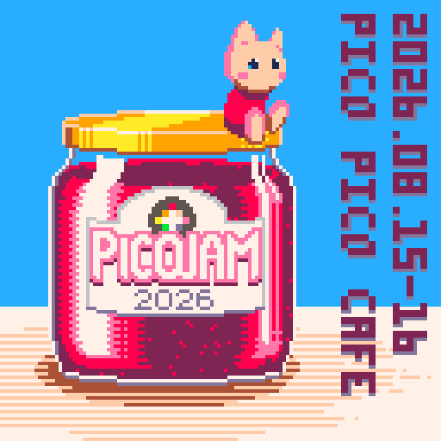
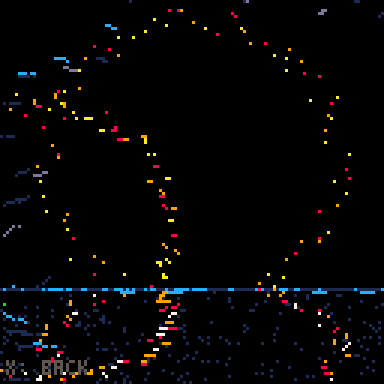
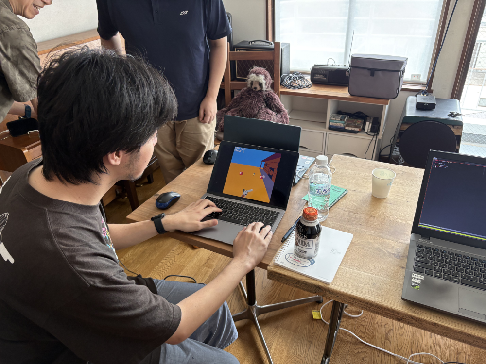
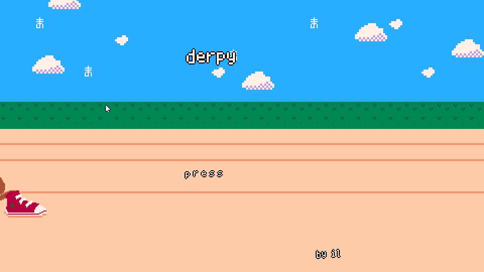
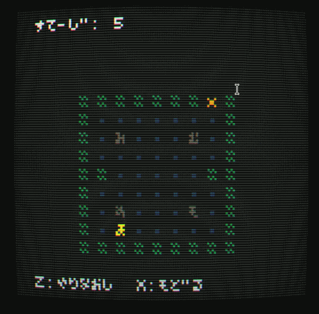
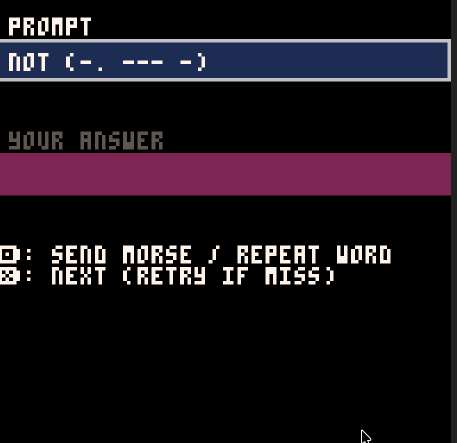
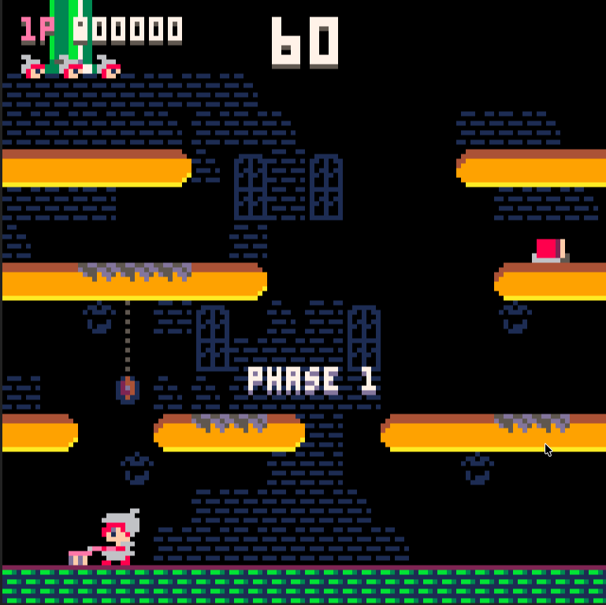
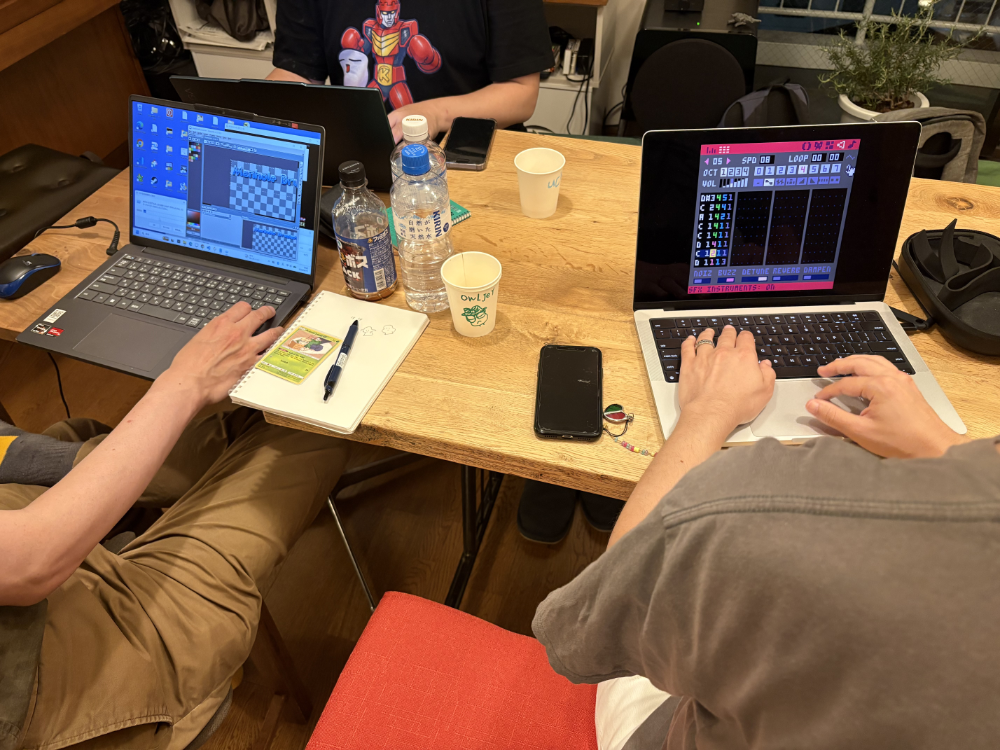

PICOJAM26のピクセルアートはmabbeesさんによるものです。

[English version is here.](/blog/posts/2026-09-23-PICOJAM-2026/)

8月に、東京のPico Pico Caféで「PICOJAM 26」を開催しました。PICO-8とPicotron限定の、2日間のオフラインゲームジャムです。

## PICO-8とPicotronって？

[PICO-8](https://www.lexaloffle.com/pico-8.php)は、小さなゲームを作って、共有して、遊ぶための「ファンタジーコンソール」です。ゲームは8ビットカラーで、コードエディタ、スプライトエディタ、マップエディタ、音楽・効果音メーカーがすべてひとつにまとまっています。Luaがベースで、やさしくて熱心なファンのフォーラムもあります。有名なところでは、Matt ThorsonさんとNoel Berryさんの[Celeste](https://www.lexaloffle.com/bbs/?tid=2145)や、donutshunterさんの[MOTION REC](https://www.lexaloffle.com/bbs/?tid=53392)も、もともとはPICO-8で作られました。

[Picotron](https://www.lexaloffle.com/picotron.php)は**ファンタジーワークステーション**、つまり架空のハードウェアのために作られた、自己完結型のクリエイティブ環境です。PICO-8と同じくLuaで動き、ゲームだけでなく、アプリや壁紙、ちょっとしたウィジェットまで作ることができます。

PICO-8やPicotronで開発すると楽しい理由はたくさんありますが、いちばんは、多くのことがあらかじめ決まっているので、「何か面白いものを作る」ことに集中できる点です。Unreal Engineを開くと、たくさんのスイッチに何時間も見入ってしまうかもしれません。でもPICO-8やPicotronなら、起動したその瞬間からゲーム作りを始められます。

## PICOJAM 26はどうだった？

昨年のテーマは「祭り・溶ける」で、夏らしい楽しいゲームがたくさん生まれました。

[昨年の開催レポートはこちらです。](/blog/posts/2025-09-08-PICOJAM-2025-JP/)

今年のテーマはぐっとコンセプチュアルで、ひらがなの「ま」でした。「間」(余白、タイミング)、「馬」、「魔」(魔法)など、「ま」から始まるいろいろな言葉に読み替えられるテーマです。

参加者は10人で、8本のゲームができあがりました。内訳はPICO-8が5本、Picotronが2本です。

( [**itch.ioのジャムページはこちら**](https://itch.io/jam/picojam26) )

Pico Pico Caféは日差しがたっぷり入る素敵な空間で、小さくてアットホームなジャムにぴったりでした。初日はほとんどの人が静かで、キーボードをカタカタ鳴らしたり、ゲームデザインに頭をひねったりしていました。参加者は日本人とそうでない人が半々くらいでしたが、会話は主に日本語でした。昼間は人が出入りしながら過ごし、夜は近くのインド料理店でみんなでカレーを食べました。

2日目になると、笑顔や笑い声があふれ、ダジャレがかたちになるたびに日本語と英語で解説が飛び交い、アニメーションはどんどんおかしくなり、効果音が加わって、みんなすっかりリラックスしていました。私のいちばんのお気に入りの瞬間は、ある参加者が別の参加者に、PICO-8用の効果音の録音をお願いしたときです。その声の演技が本当に最高で、笑いをこらえるのに必死でした。効果音が増えるほど、もうひとりの参加者の笑顔もどんどん大きくなっていきました。

これこそがジャムの隠し味、つまり「コラボレーション」と「おふざけ」です。働く大人にとって、2〜3日のジャムに申し込むにはなかなか勇気がいります。「子どもの世話はどうしよう?」「その日は家の用事があるな…」「仕事で疲れているし…」と考えてしまいますよね。どれももっともな理由ですし、主催者の私もよく考えます。それでも毎年、ジャムの週末がどれだけ楽しくて元気をもらえるものか、驚かされます。

週末が終わると、新しい仲間の顔ぶれと、じっくり遊べる新しいゲーム、そして「自分も何か新しいものを作れた」という新たな自信が手元に残ります。

私は年に2回ジャムを主催しています。1月のGlobal Game Jam(40人以上)と、8月のPICOJAM(10人ほど)です。

## ゲーム紹介

[mabbeesさんがまとめカートリッジを作ってくれました!](https://www.lexaloffle.com/bbs/?tid=159785) (Picotronのゲームは含まれていません。)

### Derpy Derby (Picotron)

**制作:** [Acedio](https://acedio.itch.io/), [illuminesce](https://illuminesce.itch.io/), and [zep](https://zep.itch.io/)

私たちのチームのゲームです!

馬の前脚と後ろ脚をそれぞれ別々に動かして、レースに勝つタイピングゲームです。

私はこのジャムを、Picotronでの開発をもっと学ぶ機会として使いました。メインプログラマーはAcedioさんでしたが、私はPicotron DriveをGitにつなぐ方法や、カスタムカラーパレットの指定方法を教わりました。正直なところ、最初に渡したスプライトはかなり小さかったんです。PICO-8の解像度に慣れきっていて、Picotronの解像度がずっと大きいことを忘れていました!Acedioさんと一緒に改善を重ねたので、その成果もぜひ見てください。

( [**itch.ioでプレイ**](https://illuminesce.itch.io/derpy-derby) | [**Lexaloffle BBSでプレイ**](https://www.lexaloffle.com/bbs/?tid=158729) )

### ほ-のぼうけん (PICO-8)

**制作:** [donutshunter](https://donutshunter.itch.io/), [CornetTheory](https://cornettheory.itch.io/)

世界が自分のまわりにどうおさまっているのかを探っていく、謎めいたキャラクターを操作します。かわいいストーリーのある、倉庫番スタイルのRPGです。

donutshunterさんの仕事は本当に見事で、シンプルで見分けやすいキャラクターデザインのセンスが光っています。ゲームには、CornetTheoryさんの素晴らしいボイス演技が、ぎゅっと圧縮されて収録されています。

( [**itch.ioでプレイ**](https://donutshunter.itch.io/gestalt-ma) | [**Lexaloffle BBSでプレイ**](https://www.lexaloffle.com/bbs/?tid=159607) )

### マホウ豆腐 (PICO-8)

**制作:** [mabbees](https://mabbees.itch.io/), [illuminesce](https://illuminesce.itch.io/)

魔法の本も料理の本も、どこかに置き忘れてしまったようです。文字の形は自分で見つけ出すしかありません。がんばってください、シェフ!

mabbeesさんも独特のスタイルの持ち主で、それは私たちが一緒に作った[Tomodachi 8in1](https://illuminesce.itch.io/tomodachi-8in1)を通して磨かれてきたものです。超リアルでピクセルパーフェクトな食べ物は、思わずよだれが出てしまうほど。私もスプライトの一部を手伝い、スタイルが合うよう心がけました。

( [**itch.ioでプレイ**](https://mabbees.itch.io/maho-tofu) | [**Lexaloffle BBSでプレイ**](https://www.lexaloffle.com/bbs/?tid=158727) )

### The Good, The Bad, and the PICO-8. (PICO-8)

**制作:** [hiko](https://hikokyoujurou.itch.io/), [mabbees](https://mabbees.itch.io/)

頼れる6連発の拳銃を手に、さまざまな銃撃戦に挑み、西部いちばんの早撃ちを目指しましょう!

hikoさんは最初から、Miyoo Miniで遊べる西部劇風のシューティングを作りたいと考えていて、ゲームプレイもそれによく合っています。西部劇らしい音楽はmabbeesさんが担当しました!

( [**itch.ioでプレイ**](https://hikokyoujurou.itch.io/duel-pico) | [**Lexaloffle BBSでプレイ**](https://www.lexaloffle.com/bbs/?tid=159703) )

### Dit Dit Dah (PICO-8)

**制作:** [Kenta Saito](https://kenta-saito.itch.io/), [CornetTheory](https://cornettheory.itch.io/)

モールス信号をモチーフにした記憶ゲームです。まずパターンを聞いて、それを再現してみましょう。判定は、短点・長点・無音のパターンで行われます。ぴったり合えば「great!」、近ければ「close」、外れると「bad」です。ミスしたあとは、直前の入力を見ながら同じ単語にもう一度挑戦できます。

KentaさんにとってPICO-8でのジャム参加はこれが初めてで、「このゲームを形にできないかも」という不安や困難に勇敢に立ち向かってくれました。とてもユニークなゲームプレイの、素晴らしいプロトタイプです。

( [**itch.ioでプレイ**](https://itch.io/jam/picojam26/rate/4902289) | [**Lexaloffle BBSでプレイ**](https://www.lexaloffle.com/bbs/?tid=158726) )

### Manhole Brushers (PICO-8)

**制作:** [uchuzine](https://uchuzine.itch.io/), [Owljey](https://owljey.itch.io/)

パイプをピカピカにしなければならない2人のブラシ係を描いた、2人プレイの「どこかで見たような、でもれっきとした別物」のゲームです。ブラシで汚れをこすり、水を流して、しゃがむのもお忘れなく!

このゲームは、uchuzineさんとshomaさんがGlobal Game Jamで作った[TRUST ME](https://www.lexaloffle.com/bbs/index.php?tid=140024)と重なるところがたくさんあります。

([**itch.ioでプレイ**](https://uchuzine.itch.io/manhole-brushers) | [**Lexaloffle BBSでプレイ**](https://www.lexaloffle.com/bbs/?pid=194831) )

### The Chat (Picotron)

**制作:** [zep](https://zep.itch.io/)

「間(スペース)」をテーマにした2人プレイのゲームです。ここでの「間」とは、お互いが話したり、笑ったり、ふざけたりするための余白のこと。やさしくてシンプルなゲームですが、コミュニケーションについて多くのことを語りかけてきます。遊んでいると、思わず笑顔になってしまいます。

ほ-のぼうけんとDit Dit Dahの両方でボイスを担当してくれた[CornetTheory](https://cornettheory.itch.io/)さんにも、ぜひ拍手を。いまは実験的なパーリンノイズのゴルフゲームを作っているそうで、まるでジャムがまだ終わっていないかのようです…がんばってください。

ちなみに、[PICO-8のまとめカートリッジはこちらです](https://www.lexaloffle.com/bbs/?tid=159785)。(Derpy DerbyとThe Chatは含まれません)。

### 面白そう!どうやって参加できますか?

来年の日程はまだ決まっていませんが、私のTwitterのほか、Pico Pico CaféやPicotachiを通じてお知らせします。東京にお住まいなら、ぜひPicotachiに遊びに来てください。常連さんの多くがPICOJAMにも参加していて、通ううちに、楽しくてあたたかいコミュニティと知り合えるはずです。

[私のTwitter]((https://x.com/its_illuminesce) / [Pico Pico CaféのTwitterをフォロー](https://x.com/picopicocafe)

みなさん、おつかれさまでした!1月のGlobal Game Jamと、来年8月のPICOJAMでまたお会いしましょう!

<3, CJ

---

### 関連記事

- [PICOJAM 2025 アフターレポート](/blog/posts/2025-09-08-PICOJAM-2025/)
- [ガラスでピコンを作ってみた](/blog/posts/2025-12-30-Picon-JP/)

すべての[記事](/tags/japanese/)を見る。
